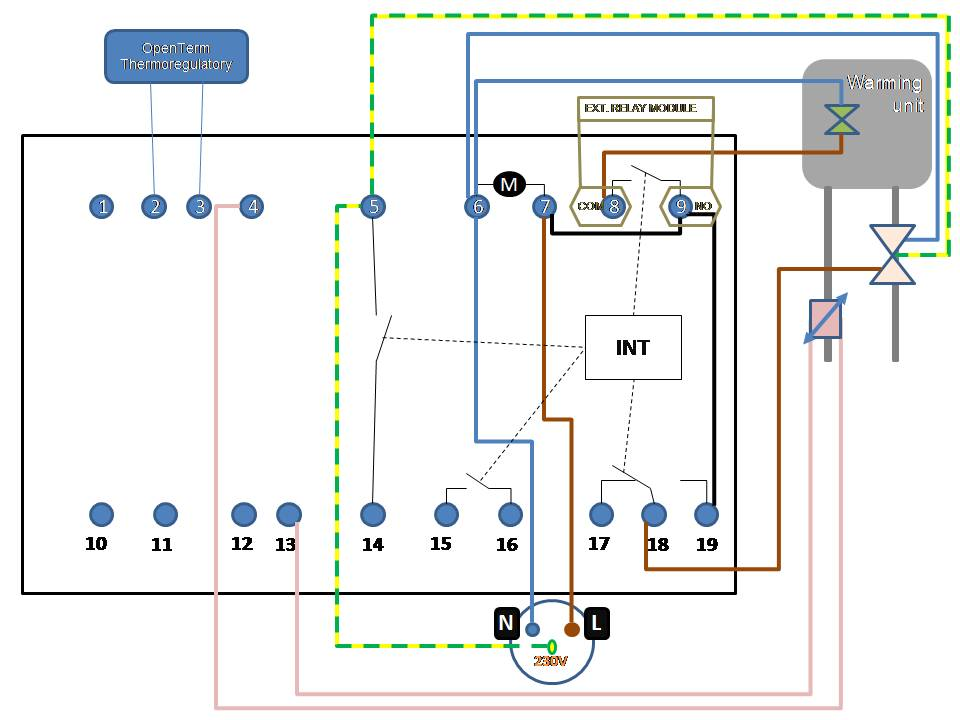

# Multi-Zone ESP-NOW Thermostat for Stadsverwarming (District Heating)

A reliable, cloud-free, multi-zone wireless thermostat system built with **M5Stack** (ESP32) and **NodeMCU** (ESP8266). Designed specifically to add independent upper-floor heating control to legacy Dutch district heating (*stadsverwarming*) installations—such as **AGH Orion (Danfoss)** heat delivery stations paired with a **Theben OT-Box RAMSES 855 top**.

---

## 🌟 Key Features

* **100% Cloud-Free & Offline:** Uses Espressif's **ESP-NOW** protocol for direct peer-to-peer communication without relying on Wi-Fi routers or external servers.
* **Non-Blocking State-Driven UI:** Uses `millis()` time-slicing and partial screen rendering on the M5Stack to ensure instant button response and zero screen flicker.
* **Built-In Hardware Failsafe:** If the upstairs transmitter loses power or drops off the network for more than **3 minutes**, the basement receiver automatically opens the relay (turning off heat) and illuminates a dedicated red warning LED.
* **Parallel Override Architecture:** Safely wires in parallel with existing OpenTherm/230V control boxes without disrupting domestic hot water priority (*voorrangschakeling*) or heat exchanger cooldown routines (*stilstandverlies*).
* **Scalable Multi-Floor Design:** Receiver firmware is pre-structured to listen to multiple transmitter MAC addresses simultaneously (e.g., 2nd floor and 3rd floor).

---

## 📂 Repository Structure

```text
espnow-stadsverwarming-thermostat/
├── README.md
├── M5Stack_Thermostat_TX/
│   └── M5Stack_Thermostat_TX.ino      # Main firmware for upstairs M5Stack unit
├── NodeMCU_Boiler_RX/
│   └── NodeMCU_Boiler_RX.ino          # Main firmware for basement NodeMCU receiver
└── tools/
    ├── M5Stack_Get_MAC/
    │   └── M5Stack_Get_MAC.ino        # Utility to display M5Stack STA MAC on LCD & Serial
    └── NodeMCU_Get_MAC/
        └── NodeMCU_Get_MAC.ino        # Utility to print NodeMCU STA MAC to Serial Monitor
```

---

## 🛠️ Hardware Bill of Materials (BOM)

### Upstairs Transmitter (2nd Floor)
* **Controller:** M5Stack Core Basic (ESP32)
* **Sensor:** M5Stack Unit ENV III (Sensirion SHT30 Temperature & Humidity sensor) via Grove I2C (Port A)
* **Power Supply:** 5V USB-C power adapter

### Downstairs Receiver (Boiler Room / Basement)
* **Controller:** NodeMCU V3 (ESP8266)
* **Relay Module:** 1-Channel 5V Optocoupler Relay Module (`5VRELHL`, configured to **High-Active** mode)
* **Status Indicator:** 1x 5mm Red LED + 1x 270 Ω (0.25W) current-limiting resistor
* **Enclosure:** Kradex plastic project box (for moisture protection and high-voltage isolation)
* **Power Supply:** 5V 1A Micro-USB power adapter

---

## ⚠️ High-Voltage Safety Disclaimer

> **WARNING:** Integrating this project into a **Theben OT-Box RAMSES 855 top** or **AGH Orion** unit involves working with **230V AC mains electricity**. 
> * Always unplug the district heating station and control box from the 230V wall outlet before opening enclosures or touching screw terminals.
> * Verify 0V AC with a multimeter before handling wires.
> * House the NodeMCU and relay module inside a sealed plastic enclosure to keep low-voltage 5V electronics physically isolated from 230V AC lines.

---

## 🔌 Wiring & Pinout Guide


### 1. NodeMCU Receiver (Low-Voltage Side)
*Set the yellow hardware jumper on the 5V relay module to **`H` (High-Active)**.*

| Component | Pin / Leg | NodeMCU Pin | Notes |
| :--- | :--- | :--- | :--- |
| **Relay Module** | `DC+` | `VIN` / `5V` | Draws 5V directly from USB input |
| **Relay Module** | `DC-` | `GND` | Common Ground |
| **Relay Module** | `IN` | `D1` (`GPIO5`) | High-Active trigger (`HIGH` = ON, `LOW` = OFF) |
| **Alarm Red LED** | Anode (+, Long leg) | `D2` (`GPIO4`) | Illuminates when ESP-NOW link times out |
| **Alarm Red LED** | Cathode (-, Short leg) | `GND` | **Connect via 270 Ω resistor** |
| **Onboard Green LED** | Built-in | `D4` (`GPIO2`) | Active-High status indicator |

### 2. Boiler Room Parallel Connection (230V AC Side)
In a standard **Theben OT-Box RAMSES 855 top** setup controlling an **AGH Orion** station, pins `7`, `9`, and `19` are bridged together as the permanent 230V Live Phase (`L`), while pin `8` routes switched phase to the primary heating zone valve.

Connect the dry contacts of your relay in parallel across the internal heating relay:

```text
  Theben RAMSES 855 top Terminal Block (230V AC)
  
  [Permanent Live Phase]           [Switched Heating Valve]
      ┌──────┴──────┐                  ┌──────┴──────┐
      │ Terminal 7  │                  │ Terminal 8  │
      └──────┬──────┘                  └──────┬──────┘
             │                                │
      ┌──────┴──────┐                  ┌──────┴──────┐
      │ Terminal NO │                  │Terminal COM │
      │ (5V Relay)  │                  │ (5V Relay)  │
      └─────────────┘                  └─────────────┘
```

*Note: Ensure analog thermostatic radiator valves (thermostaatknoppen) on the ground floor are functioning properly so the 1st floor does not overheat when the 2nd floor requests heat.*

---

## 💻 Software Setup & Flashing

### Prerequisites
1. **Arduino IDE** (Tested with ESP32 Board Core `2.0.17` and ESP8266 Board Core `3.1.2`).
2. **Libraries for M5Stack:**
   * `M5Stack`
   * `M5UnitENV`
3. **Libraries for NodeMCU:**
   * `ESP8266WiFi` and `espnow` (Included in the ESP8266 board package)

### Step-by-Step Deployment

1. **Retrieve Both STA MAC Addresses:**
   * **NodeMCU:** Flash `tools/NodeMCU_Get_MAC/NodeMCU_Get_MAC.ino` to your NodeMCU. Open the Serial Monitor (`115200 baud`) and copy the formatted C++ byte array (e.g., `{0xAA, 0xBB, 0xCC, 0xDD, 0xEE, 0xFF}`).
   * **M5Stack:** Flash `tools/M5Stack_Get_MAC/M5Stack_Get_MAC.ino` to your M5Stack. Read the formatted C++ byte array directly off the M5Stack LCD screen (or Serial Monitor).
2. **Configure & Flash the Transmitter (`M5Stack_Thermostat_TX`):**
   * Open `M5Stack_Thermostat_TX/M5Stack_Thermostat_TX.ino` and paste your **NodeMCU's** MAC array into `receiverAddress[]`:
     ```cpp
     uint8_t receiverAddress[] = {0xAA, 0xBB, 0xCC, 0xDD, 0xEE, 0xFF};
     ```
   * *(Optional)* Calibrate `TEMP_OFFSET` by placing the ENV III sensor next to a trusted reference thermometer for 30 minutes and entering the delta (e.g., `-0.3`).
   * Upload the sketch to the M5Stack.
3. **Configure & Flash the Receiver (`NodeMCU_Boiler_RX`):**
   * Open `NodeMCU_Boiler_RX/NodeMCU_Boiler_RX.ino` and paste your **M5Stack's** MAC array into `MAC_FLOOR_2[]`:
     ```cpp
     const uint8_t MAC_FLOOR_2[] = {0x11, 0x22, 0x33, 0x44, 0x55, 0x66};
     ```
   * Upload the sketch to the NodeMCU.

---

## 🎛️ Operation & Diagnostics

* **Controls:** Use **Button A (Left)** to decrease target temperature by `0.5°C` and **Button C (Right)** to increase it by `0.5°C`.
* **Hysteresis:** The thermostat uses a `±0.2°C` deadband around the target temperature to prevent rapid relay cycling.
* **Connection Status Icon (Bottom-Right):**
  * **Green Radar Arcs:** ESP-NOW packets are actively acknowledged by the basement receiver every 30 seconds.
  * **Red Warning Triangle (`X`):** Transmission failed or receiver is offline.
* **Receiver LEDs:**
  * **Green ON / ORANGE OFF:** Healthy link; system operating normally.
  * **Green OFF / Red ON:** Link lost for >3 minutes; failsafe triggered and heating relay forced open.
